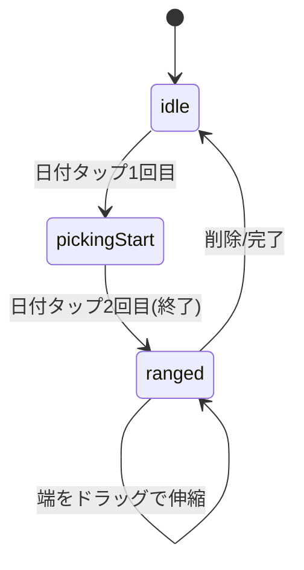

# coyomi. 技術設計書

2026-09-18 · @kaw4shima

## 概要とコンセプト

coyomi.は、生理日を「さりげなく」管理できるiOSカレンダーアプリ。見た目は普通のカレンダーそのものだが、日付の下に引かれた一本の線(リボン)だけで生理期間を示す。

- 予定管理アプリとして単体で成立させながら、生理周期の記録・予測を控えめな機能として統合する。UI上に「生理」という語は一切出さない。
- 男女問わず・肩越しに画面を見られても「生理管理アプリ」だと分からないことを最重要条件とする。
- 対象ユーザーは性別を問わず、予定管理と体調管理を一つのアプリで済ませたい人。

本ドキュメントは、coyomi.のコンセプト資料(画面設計スライド、2026.09)をもとに、React Native/Expoでの実装を前提とした技術設計をまとめたもの。最終的にはClaude Codeでの実装に引き継ぐことを想定する。

## 設計原則(実装上の制約条件)

コンセプト資料の3原則を、実装レベルのルールに落とす。

| 原則 | 実装上の制約 |
| --- | --- |
| 01 肩越しに読めない | 生理期間を示す記号は2pxの線一本のみ。ラベル・アイコン・ピンク系の面は一切使用しない。UI文言・アクセシビリティラベル(VoiceOver)にも「生理」の語を入れない |
| 02 まず普通のカレンダー | 予定・祝日が主役。周期情報(リボン・予測破線)は日付セルの下部に控えめに配置し、予定の表示ロジックより優先度を下げる。体調メモの詳細は日付詳細画面の中にしか出さない |
| 03 男女問わず持てる | 配色は紙のオフホワイトとテラコッタ1色を基調とし、ピンク系を使わない。書体はSan Francisco(iOS標準)に揃える |

実装上のチェックリストとして:

- コンポーネント名・変数名・コメントにも「生理」を直接使わず、`cycle` / `period` など中立的な英語を用いる
- カテゴリー色の9色パレットとテラコッタ(記号用)を完全に分離し、カテゴリー色をリボンに流用しない
- 進捗通知・ウィジェット・ロック画面プレビューなど、アプリの外に情報が漏れうる全面でも同様の配慮を必須とする(§9で詳述)

## 技術スタック

| 領域 | 選定 | 理由 |
| --- | --- | --- |
| フレームワーク | React Native + Expo (SDK最新) | iOS単一ターゲットだが、Expoのbuild/EAS SubmitでApp Store提出までの実績が多く、OTA更新も利用できる |
| 言語 | TypeScript | データモデル(Event/CycleRecord等)の型安全性を担保 |
| ナビゲーション | React Navigation (Bottom Tabs + Native Stack + Modal) | カレンダー/設定の2タブと、下から上がるシート(日付詳細・体調メモ・記録)を再現 |
| 状態管理 | Zustand | Reduxより軽量で、カレンダー/設定/記録のグローバル状態をシンプルに扱える |
| ローカル保存 | expo-sqlite (候補: WatermelonDB) | 予定・記録・メモは件数が増え、日付範囲検索(月表示)が頻発するため、AsyncStorageの単一KVよりSQLクエリが向く。設定値(Settings)はAsyncStorageでも可 |
| 日付処理 | date-fns (+ date-fns-tz不要、ローカル固定) | 軽量で、週開始曜日切り替えや連続日判定の関数が豊富 |
| フォーム | React Hook Form (予定編集・体調メモ入力) | バリデーションと入力状態管理の一元化 |
| 通知 | expo-notifications | ローカル通知でリマインダーを送信。文言は中立表現にし、生理関連であることが分からないようにする(§9参照) |
| アイコン/フォント | @expo/vector-icons、Systemフォント(San Francisco相当) | iOSではReact Nativeの`fontFamily: 'System'`が既にSan Franciscoに対応 |

### ディレクトリ構成案

```
src/
  app/                 # 画面(screens)
    calendar/
      MonthScreen.tsx
      DayDetailSheet.tsx
      NewEventScreen.tsx
    record/
      RecordScreen.tsx
    note/
      DailyNoteScreen.tsx
    settings/
      SettingsScreen.tsx
      CycleSettingsScreen.tsx
      CalendarSettingsScreen.tsx
      AboutScreen.tsx
  components/          # 共通 UI (MonthGrid, DayCell, Ribbon, CategoryChip 等)
  store/               # Zustand store (events, categories, cycleRecords, notes, settings)
  db/                  # expo-sqlite 初期化・マイグレーション・クエリ関数
  domain/              # リボン描画ロジック・周期予測ロジックなどの純粋関数
  theme/               # デザイントークン(色・余白・タイプスケール)
  types/               # TypeScript型定義
```

## データモデル

主エンティティは5つ: Event、Category、CycleRecord、DailyNote、Settings。

### Event(予定)

```ts
interface Event {
  id: string;
  title: string;
  isAllDay: boolean;
  startAt: string;   // ISO8601
  endAt: string;     // ISO8601
  categoryId: string | null;
  location?: string;
  memo?: string;
  reminderMinutesBefore?: number; // 既定 30
  recurrenceRule?: { freq: 'daily' | 'weekly' | 'monthly' | 'yearly'; interval?: number } | null; // 毎日/毎週/毎月/毎年の繰り返しに対応
  createdAt: string;
  updatedAt: string;
}
```

### Category(カテゴリー)

```ts
interface Category {
  id: string;
  name: string;      // 仕事 / プライベート / 学び / ユーザー定義
  colorHex: string;  // 9色パレットから選択、または自由入力
  isDefault: boolean;
  order: number;
}
```

### CycleRecord(周期の記録 = 生理期間)

```ts
interface CycleRecord {
  id: string;
  startDate: string; // 'YYYY-MM-DD'
  endDate: string | null; // null = 進行中(未定)
  createdAt: string;
  updatedAt: string;
}
```

### DailyNote(体調メモ)

```ts
interface DailyNote {
  id: string;
  date: string; // 'YYYY-MM-DD'、1日1件
  bodyTags: string[];  // 頭が重い/お腹の痛み/眠い/だるい/肌あれ/食欲 など(複数選択可)
  moodTags: MoodTag[];  // 'irritable' | 'anxious' | 'down' | 'restless' | 'unmotivated' | 'unfocused' | 'energetic' | 'calm' | 'motivated'(複数選択可)
  text?: string;
  updatedAt: string;
}
```

### Settings(設定)

```ts
interface Settings {
  cycleLengthDays: number;   // 既定 28
  periodLengthDays: number;  // 既定 5
  weekStartsOn: 0 | 1 | 6;   // 日曜/月曜/土曜
  showWeekendColor: boolean;
  weekendColorMode: 'redBlue' | 'shadeOnly';
  showHolidays: boolean;
  showForecast: boolean;
}
```

すべてのエンティティはローカルSQLiteの別テーブルに対応させ、アプリ起動時にZustand storeに読み込む。

## 画面構成とナビゲーション

根はBottom Tabs 2本(カレンダー・設定)。記録はタブに入れず、カレンダー画面のヘッダーボタンから遠む。

```mermaid
flowchart TD
  Tabs[Bottom Tabs] --> Month[カレンダー: 月表示]
  Tabs --> Settings[設定タブ]
  Month -->|日付タップ| DayDetail[日付詳細シート]
  Month -->|➕ボタン| NewEvent[予定の追加]
  Month -->|記録ボタン| Record[記録(期間)シート]
  DayDetail -->|予定を追加| NewEvent
  DayDetail -->|体調メモ| DailyNote[体調メモ画面]
  Settings --> CycleSettings[周期の設定]
  Settings --> CalendarSettings[カレンダー設定]
  Settings --> About[アプリ情報]
```

| 画面 | 提示方式 | 内容 |
| --- | --- | --- |
| 月表示 | タブのルート | グリッド、予定2件+他N件、生理リボン/予測破線/体調点 |
| 日付詳細 | 下から上がるモーダル(react-native-modalize等) | 終日/時間付予定一覧、体調メモ行、予定を追加ボタン、左右ノブで前後の日 |
| 予定の追加/編集 | Modal(Native Stack) | タイトル・終日トグル・日付・時刻・カテゴリーチップ・通知・繰り返し・場所・メモ |
| 記録(期間) | Modal | 状態カード(記録中N日目)、範囲選択カレンダー、「今日で終わりにする」、これまでの記録一覧 |
| 体調メモ | Modal | 日付ストリップ、からだ/こころタグ、自由記述 |
| 設定 | タブのルート | 「周期の設定」「カレンダー設定」「アプリ情報」の3行のみ |
| 周期の設定 | Stack push | 平均周期・平均日数、予測表示ON/OFF |
| カレンダー設定 | Stack push | 週開始曜日、土日色、祝日表示、プレビュー |
| アプリ情報 | Stack push | アイコン・バージョン、規約・ポリシー・ライセンス、問い合わせ |

## 主要コンポーネント設計

### MonthGrid / DayCell

月表示は7列×可変行のグリッド。各DayCellは以下の項目を重ねて描画する(上から順):

1. 日付数字(今日は黒丸背景)
2. 体調メモの小さな点(日付の右)— 生理日のみでは出さない。DailyNoteが存在する日のみ表示
3. リボン(実線) / 予測(破線) — 日付の直下、固定位置(予定件数に依存しない)
4. 予定リスト(最大2件、超えた分は「他N件」)

```ts
function getRibbonSegments(cycleRecords: CycleRecord[], weekStart: Date, weekEnd: Date): RibbonSegment[]
// 週単位でセグメントを切り出し、開始/終了のみ角丸(2px)を付与する
```

予定の省略表示ロジック: セルの高さが固定なので、1日あたり表示可能件数(2件)を超えた場合のみ「他{n}件」を最後の行に挿入する。

### DayDetailSheet

`@gorhom/bottom-sheet` を使用し、背後のカレンダーは暗くなるだけで残す(アンマウントしない)。高さは内容量に応じて可変で、予定が多い日はシート内部のみスクロールさせる。左右のつまみ(chevron)で`selectedDate`を±1日するだけの単純な状態遷移として実装する。

### RecordRangePicker(期間記録のカレンダー)

状態は `idle -> pickingStart -> pickingEnd -> ranged` の単純な状態機械で管理する。



「今日で終わりにする」はendDate未確定のCycleRecordに対して一発で`endDate = today`をセットするショートカット。

### 予定フォーム(NewEventScreen)

チップ形式の種別選択は廃止し、iOS標準の行リスト(終日トグル/日付/時刻/カテゴリー/通知/繰り返し/場所/メモ)だけで構成する。終日トグルオンで時刻行を非表示にするアニメーションを付ける。

## コアロジック(周期予測・描画判定)

すべて `src/domain/` に純粋関数として実装し、UIと分離してテストできるようにする。

### 予測ロジック

```ts
function predictNextCycles(records: CycleRecord[], count = 2): PredictedRange[] {
  // 直近3回のCycleRecord(endDate確定済み)から
  // avgCycleLength = 直近3回のstartDate間隔の平均
  // avgPeriodLength = 直近3回の(endDate - startDate)の平均
  // 最新のstartDate + avgCycleLength を起点に count 回分の予測範囲を返す
}
```

- 記録が1〜2回しかない場合はSettingsのcycleLengthDays/periodLengthDaysを代用し、記録が増えるほど実績値に切り替わる
- 予測範囲は`showForecast`がfalseの間はカレンダーに描画しない

### リボン描画ロジック

- リボンと予測線は週単位(行単位)でセグメント化し、行をまたぐ部分で必ず切れる(1本の連続した回帰コンポーネントではなく、週ごとに描画)
- 角丸(2px)はその週の中で実際に開始/終了する日のみに付与する(途中で切れた日はフラット端)
- 実績(CycleRecord)と予測(PredictedRange)が同一日に重なる場合は実績を優先し、予測は描画しない

### 体調メモの点表示判定

```ts
function shouldShowNoteDot(date: string, notes: DailyNote[]): boolean {
  const note = notes.find(n => n.date === date);
  return !!note && (note.bodyTags.length > 0 || note.moodTag !== null || !!note.text);
}
```

生理日であるだけでは点を出さない(原則02の実装として重要)。DailyNoteが実際に入力された日のみ判定する。

## デザイントークン

`src/theme/tokens.ts` に一元化し、コンポーネントからは必ずこのファイル経由で参照する(ハードコードしない)。

| トークン | 値 | 用途 |
| --- | --- | --- |
| color.paper | #FBF9F6 | 背景 |
| color.ink | #1B1A18 | 文字・今日の背景 |
| color.terracotta | #A8543C | 記号(リボン・強調)専用。カテゴリー色には使わない |
| color.sunday | #9A4F49 | 日曜日の日付文字色 |
| color.saturday | #4E6E83 | 土曜日の日付文字色 |
| color.category[9] | #4A6B63, #8A5A46, #3F6C8E, #8E5570, #8A6A3C, #3A3733, #7A6AA0, #6E7F4A, #5E7E86 | カテゴリー色パレット(彩度を落として紙とインクの間に収めた9色) |
| font.family | System (iOS: San Francisco) | 太さ差と等幅数字(`fontVariant: ['tabular-nums']`)だけでリズムを作る |
| radius.card | 12–16 | カード・シートの角丸 |
| radius.ribbonEnd | 2px | リボンの開始/終了端のみ |
| stroke.ribbon | 2px | リボン・予測線の太さ |

ダークモードを将来対応する場合に備え、`useColorScheme()`で切り替えられる構造(light/darkの2セット)で最初から定義しておくことを推奨(コンセプト資料内にもダークモード用カラー値の言及あり)。

## データ永続化とプライバシー方針

コンセプト資料の方針通り、全データを端末内(expo-sqlite)のみに保存し、外部サーバーへの送信は一切行わない。なお、将来複数端末間の同期(iCloudなど)を追加する場合は、この方針とプライバシーポリシーの記載を合わせて見直す。

### 実装上の具体方策

- ローカル通知(expo-notifications)の本文には予定タイトルのみを使用し、生理関連の通知(予測開始のお知らせなど)を将来実装する場合は中立的な文言(例:「今日の記録を確認」)にする
- ウィジェットは今回のスコープ外とし、将来対応する場合もロック画面プレビューには予定タイトルのみ表示し、リボン・体調メモは含めない
- アプリ起動時のFace ID/Passcodeロックは今回のスコープ外だが、expo-local-authenticationで将来追加できるよう設定画面に余地を残す

### App Store公開に向けた課題

公開を想定しているため、以下は実装と並行して準備が必要:

- App Store Reviewガイドライン 5.1.1(ヘルス・生殖に関するセンシティブデータ)への対応: データを端末外に送信しない方針をApp Store提出時のレビューノートに明記する
- プライバシーポリシー・利用規約の実文作成(コンセプトのアプリ情報画面にリンク欄はあるが、内容は未作成)。外部送信を行わないことを明記すれば比較的シンプルに作成できる
- App Privacy詳細(App Store Connectの「プライバシー」設定)でも「データを収集しない」を選択できる構成にする(分析SDKなどを入れない)
- アプリアイコンは「7a Weekdays」案(曜日の並び+下線)を採用。ホーム画面で他アプリと並んだときに目的が分からないことを引き続き条件とする
- アプリ名は「coyomi.」(小文字+ピリオド)で確定として進める

## 決定事項の反映と残るオープン課題

Claude Codeでの実装は以下の順番を推奨。各ステップを独立した作業単位(ブランチ/PR)に切り分けやすい。

| ステップ | 内容 | 完了条件 |
| --- | --- | --- |
| 1 | Expoプロジェクト雛形、ナビゲーション骨組み、デザイントークン | 空の2タブ(カレンダー/設定)が起動し、トークンがUI全体で参照されている |
| 2 | データモデルとSQLiteスキーマ、Zustand store、月表示グリッド(予定のひもの) | ダミーデータで月表示が正しく描画される |
| 3 | 日付詳細シートと予定CRUD(追加/編集/削除)、繰り返し予定(毎日/毎週/毎月/毎年)、ローカル通知(リマインダー) | 予定の作成(繰り返し・通知含む)から月表示への反映まで一通り動く |
| 4 | 期間記録(RecordRangePicker)と予測ロジック、リボン/破線描画 | 記録を追加するとカレンダーにリボンと予測が反映される |
| 5 | 体調メモ画面、設定画面一式(周期/カレンダー/アプリ情報) | 設定値の変更が即時カレンダーに反映される |
| 6 | アイコン・スプラッシュ・プライバシーポリシー等App Store提出準備 | EAS BuildでTestFlight配信可能 |

### 決定事項

- 「通知/リマインダーを初期スコープに含めるか」という点は、含める方針に決定した。ステップ3でexpo-notificationsによるローカル通知を実装し、文言は中立表現にする
- 繰り返し予定(recurrenceRule)は毎日/毎週/毎月/毎年に対応する(決定)。自由な間隔設定(隔週など)は将来拡張とする
- ウィジェット対応は行わない(決定)。アイコンは候補7a(曜日の並び+下線)を採用する
- iOSネイティブカレンダー(EventKit)とは連携せず、アプリ内独自データとして扱う(決定、プライバシー方針と整合)
- 複数端末間のデータ同期(iCloudなど)は将来対応の可能性がある(未確定)。対応する場合は「端末内のみ保存」の前提とプライバシーポリシーの記載を見直す必要がある
